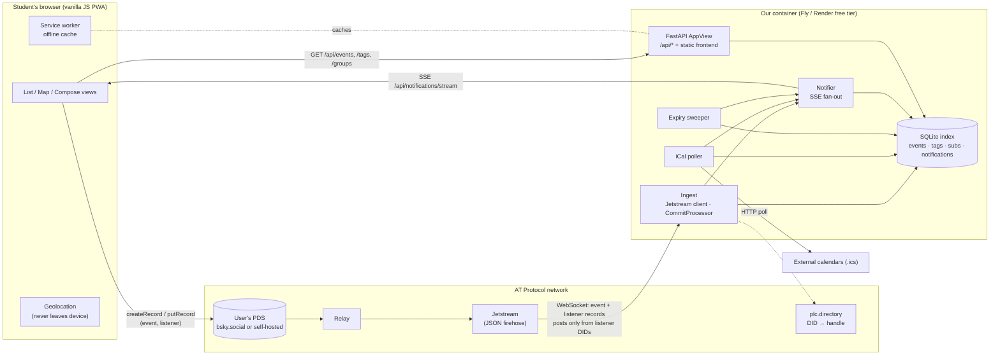

# Architecture

## Infrastructure



## How data moves

1. **Write.** The host's browser writes an `app.communitymap.event` record straight to their PDS. Our server never holds their credentials.
2. **Index.** The PDS passes the record to the relay and then to Jetstream. `JetstreamClient` sends it to `CommitProcessor`, which validates it against the lexicon and upserts it into SQLite. A cursor is saved so a restart picks up where it left off.
3. **Notify.** If an update changes something people can see (time, place, name), the processor builds a readable diff and sends it to everyone subscribed. They get it on the SSE stream, and it is also saved so they can catch up after going offline.
4. **Listeners (Host Henry).** A host can attach a listener record (event + hashtag) to an event. When that host posts on Bluesky with the hashtag, the post becomes an announcement on the event. We only subscribe to posts from accounts that have a listener, never the full firehose.
5. **Expire.** Each sweep tells subscribers that the event has ended, then deletes it from the index. The record stays on the user's PDS, since that data belongs to them.

## Code layout (each box is one team's area)

```
lexicons/            record schemas (the public contract on the network)
backend/app/
  models.py          shared Pydantic models (contract)
  store/base.py      EventStore Protocol (contract) → sqlite.py
  notify/base.py     Notifier Protocol (contract)   → service.py (SSE)
  ingest/            jetstream.py · processor.py · ical.py · handles.py · netguard.py
  api/               meta · events · subscriptions · imports · dev
  expiry.py seed.py views.py
  main.py            composition root (the only file that knows concrete classes)
frontend/src/
  api.js cache.js store.js filters.js geo.js subscriptions.js
  atproto.js devWriter.js   (same interface, so writers can be swapped)
  views/             listView · mapView · detailView · composeView · filterBar · loginView
  app.js             wiring
```

Modules only depend on the interfaces. Swapping SQLite for Postgres, Jetstream for another feed, or Leaflet tiles for Overture only touches one file plus `main.py`.
